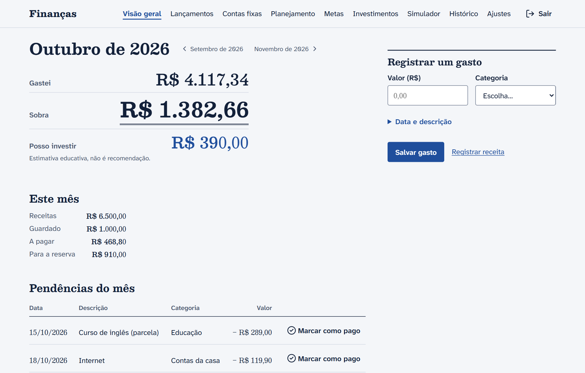
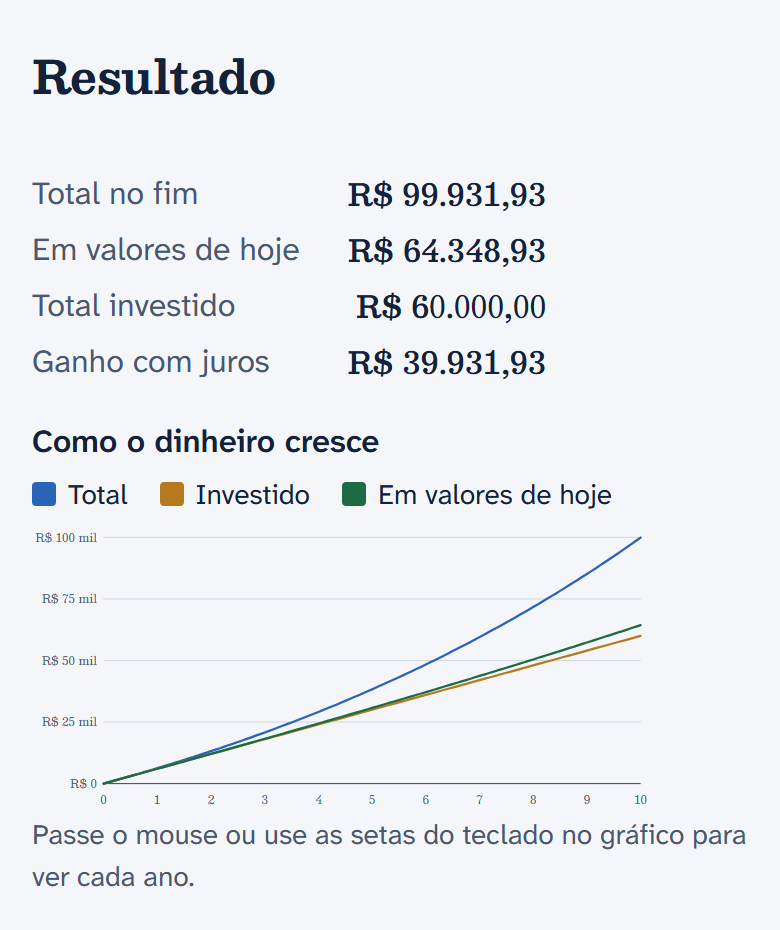
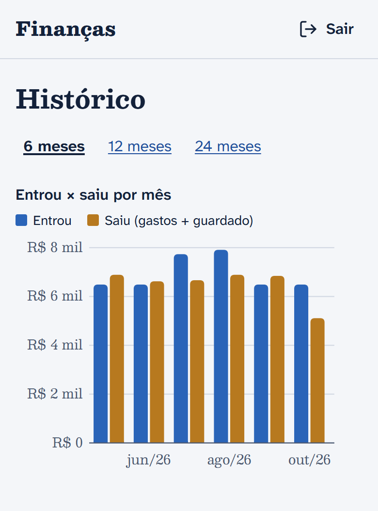
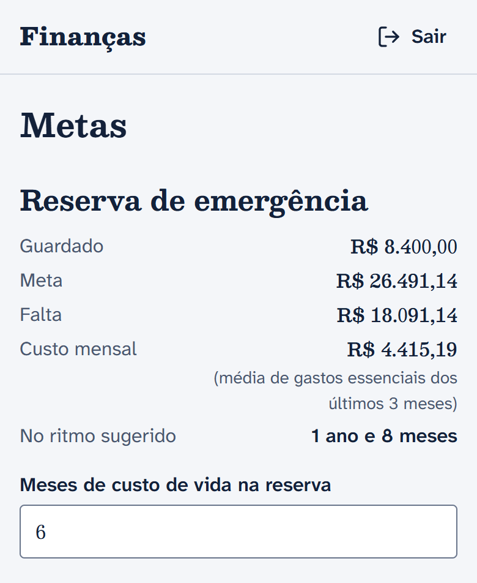

# Finanças

Controle financeiro pessoal. Você registra os gastos do mês e o app responde três perguntas logo no topo: **quanto gastei, quanto sobra e quanto posso investir**.


<picture>
  <source media="(prefers-color-scheme: dark)" srcset="docs/img/visao-geral-escuro.png">
  
</picture>

> [!NOTE]
> A sugestão de investimento é uma **estimativa educativa**, não recomendação financeira.

[Como rodar](#como-rodar) · [O que dá para fazer](#o-que-dá-para-fazer) · [Como é feito](#como-é-feito) · [Segurança](#segurança) · [Testes](#testes) · [Colocar no ar](#colocar-no-ar) · [Seus dados](#seus-dados) · [Referência](#referência)

## Destaques

- **Dinheiro em `BigDecimal`, nunca em `double`.** O simulador e o assistente desenham no navegador, mas as contas são feitas no servidor.
- **Cada pessoa só vê os próprios dados.** Toda consulta filtra pelo dono, e um teste tenta abrir o registro de outra conta em cada rota com id.
- **Funciona sem JavaScript.** O HTML já vem pronto do servidor. O JavaScript só deixa a experiência melhor.
- **Leve e acessível.** No Lighthouse (celular), o desempenho ficou entre 99 e 100 nas 7 telas medidas, e a acessibilidade ficou em 100 nas 18 telas testadas. A tela de cadastro caiu de 385 KiB, no app React antigo, para 92 KiB.
- **Segurança com referência.** Segue o OWASP Top 10 e o ASVS nível 1, com Argon2id nas senhas, CSRF, CSP sem `unsafe-inline` e limite de tentativas de login.

## Telas

<table>
  <tr>
    <td width="33%" valign="top">
      <picture>
        <source media="(prefers-color-scheme: dark)" srcset="docs/img/simulador-escuro.png">
        
      </picture>
    </td>
    <td width="33%" valign="top">
      <picture>
        <source media="(prefers-color-scheme: dark)" srcset="docs/img/historico-escuro.png">
        
      </picture>
    </td>
    <td width="33%" valign="top">
      <picture>
        <source media="(prefers-color-scheme: dark)" srcset="docs/img/metas-escuro.png">
        
      </picture>
    </td>
  </tr>
  <tr>
    <td valign="top"><b>Simulador.</b> Atualiza enquanto você digita.</td>
    <td valign="top"><b>Histórico.</b> Entrou × saiu nos últimos 6, 12 ou 24 meses.</td>
    <td valign="top"><b>Metas.</b> Quanto falta para a reserva e em quanto tempo.</td>
  </tr>
</table>

As capturas usam os dados de exemplo do próprio app e seguem o tema claro ou escuro do seu GitHub.

## Como rodar

Você precisa do **Java 25** (Temurin) com o `JAVA_HOME` configurado. O Maven não precisa ser instalado: o `mvnw` baixa a versão certa e confere o checksum dela.

No Git Bash, Linux ou macOS:

```bash
./mvnw spring-boot:run -Dspring-boot.run.profiles=dev
```

No PowerShell:

```powershell
.\mvnw.cmd spring-boot:run "-Dspring-boot.run.profiles=dev"
```

No PowerShell, tudo o que começa com `-D` vai entre aspas. Sem elas, o PowerShell quebra o argumento no primeiro ponto (`-Dspring-boot` e `.run.profiles=dev`).

Depois abra http://localhost:8080. O banco de desenvolvimento (H2) fica na pasta `./data`, fora do git.

| Comando | Para quê |
|---|---|
| `./mvnw test` | Roda os testes JUnit 5 |
| `./mvnw verify` | Roda os testes e gera o `.jar` em `target/` |
| `node --test "src/test/js/**/*.test.mjs"` | Roda os testes do JavaScript (Node 22 ou mais, sem instalar nada) |
| `./mvnw dependency-check:check` | Procura vulnerabilidades nas dependências. Precisa da `NVD_API_KEY` (veja em [Referência](#referência)) |

### Primeiro acesso

1. Clique em **Criar conta**. A senha precisa ter pelo menos 15 caracteres.
2. O app mostra o **código de recuperação** uma vez só. Anote: é com ele que se cria uma senha nova se a antiga for esquecida.
3. Na visão geral, use **Configurar em 1 minuto**. O assistente pergunta a renda, a regra de divisão (50/30/20, por exemplo), as contas fixas e a reserva de emergência. Se preferir, escolha **Explorar com dados de exemplo** (6 meses fictícios) para ver as telas cheias.

Para voltar ao começo sem perder a conta, use **Ajustes → Recomeçar do zero**.

### Perfis

| Perfil | Banco | Para quê |
|---|---|---|
| `dev` | H2 em arquivo (`./data`, fora do git) | Desenvolver no próprio computador |
| `test` | H2 em memória | Usado pelos testes |
| nenhum (produção) | PostgreSQL, pelas variáveis de ambiente | Servidor de verdade |

## O que dá para fazer

| Tela | O que faz |
|---|---|
| **Visão geral** | Mostra quanto gastei, quanto sobra e quanto posso investir. Logo abaixo ficam o lançamento rápido (valor, categoria e salvar, com a data de hoje e as categorias mais usadas primeiro), as pendências do mês, com o botão "Marcar como pago", e uma barra por pote dizendo quanto do planejado já foi usado. |
| **Lançamentos** | Lista o mês, com busca e filtros por tipo, categoria e situação (pendentes ou pagas). Tocar num lançamento abre a edição, onde também dá para apagar. |
| **Contas fixas e parcelas** | Cada mês já começa com elas lançadas como pendentes, a pagar ou a receber. Mudar uma conta muda os lançamentos ainda não pagos dali em diante. Apagar tira os lançamentos futuros e deixa o histórico. |
| **Planejamento** | Define a regra que divide a renda em potes. Há quatro prontas: 50/30/20, 70/20/10, 6 potes e "pague-se primeiro" (80/20). Editar os potes cria uma regra sua. Cada categoria fica num pote e pode ter limite mensal. |
| **Metas** | Calcula a reserva de emergência (quantos meses de custo de vida guardar e quanto falta). Também guarda metas com valor e prazo e diz quanto guardar por mês para chegar lá. |
| **Investimentos** | Tem o questionário de perfil (as respostas ficam no navegador), a carteira sugerida e um assistente que responde com os seus números, sem IA externa. |
| **Simulador** | Simula juros compostos com inflação e aumento do aporte a cada ano. Atualiza enquanto você digita e mostra gráfico e tabela ano a ano. |
| **Histórico** | Mostra entradas × saídas por mês, em gráfico e tabela, e os gastos por categoria. |
| **Ajustes** | Reúne nome, tema (escuro, que é o padrão, claro ou o do aparelho), troca de senha, novo código de recuperação, backup, dados de exemplo, recomeçar do zero e excluir a conta. |

Apagar qualquer registro (lançamento, conta fixa, meta, pote ou categoria) mostra **Desfazer** por 10 minutos.

Sem JavaScript, tudo continua funcionando: os formulários vão para o servidor e apagar passa por uma página de confirmação. O JavaScript fica em módulos em [`src/main/resources/static/js`](src/main/resources/static/js), sem dependência nem build.

## Como é feito

| Parte | Tecnologia |
|---|---|
| Linguagem | Java 25 |
| Framework | Spring Boot 4.1.1, com Spring MVC, Spring Security 7.1.1 e Spring Data JPA (Hibernate 7.4.5) |
| Telas | Thymeleaf 3.1.5 e JavaScript puro |
| Banco | H2 no desenvolvimento e nos testes, PostgreSQL em produção, migrações com Flyway 12.4.0 |
| Testes | JUnit 5 e MockMvc no Java, `node --test` no JavaScript |
| Build | Maven 3.10.0, pelo wrapper |

O código segue três camadas:
- o **controller** recebe a requisição e monta a tela;
- o **service** guarda as regras;
- o **repository** faz as consultas, sempre filtrando pelo dono.

```
src/main/java/io/github/fabasdev/financas/
  domain/       entidades JPA, Money (BigDecimal) e Months
  repository/   consultas (sempre filtrando pelo dono)
  service/      regras: resumo do mês, sugestão de investimento, simulador, contas fixas, importação...
  controller/   telas (Thymeleaf), as APIs /api/simulacao e /api/assistente e o gráfico do histórico (SVG)
  security/     política de senha, limite de tentativas, filtros de sessão
  config/       Spring Security, relógio (fuso America/Sao_Paulo) e cache do JavaScript
src/main/resources/
  db/migration/ V1 (tabelas), V2 (regras 50/30/20, 70/20/10, 6 potes e 80/20), V3 (tema na conta) e V4 (escuro como padrão)
  security/     listas de senhas comuns, com a licença
  templates/    HTML das telas (fragments/icons.html: ícones Lucide)
  static/css/   tokens.css (cor, tipografia, espaçamento) e app.css
  static/fonts/ fontes Besley e Atkinson Hyperlegible Next, com as licenças
  static/js/    melhorias em JavaScript (simulador, questionário, assistente, validação de formulário, "Mais" do celular)
src/test/java/  testes JUnit 5 (perfil test, H2 em memória)
src/test/js/    testes do JavaScript (node --test)
legacy-web/     app React antigo (até a importação dos dados ser conferida)
docs/           plano, entrega final, auditoria, medições do Lighthouse e as capturas do README
```

### Visual

A direção é a **noite azul**: fundo azul-marinho escuro, texto claro, um azul-céu de destaque e vermelho só para valor negativo. O tema claro (papel frio, tinta azul-marinho e azul-cobalto) e o automático, que segue o aparelho, ficam em Ajustes, guardados na conta. Os valores usam a fonte Besley com algarismos tabulares, e o saldo leva o traço duplo da contabilidade. No celular, a navegação fica numa barra embaixo, perto do polegar: Início, Lançamentos, Metas e "Mais".

Cor, tipografia e espaçamento ficam todos em [`tokens.css`](src/main/resources/static/css/tokens.css), e o resto do CSS só usa esses nomes. O plano de design está em [`docs/plano.md`](docs/plano.md), nas partes "Como a Fase 4 ficou" e "Noite azul".

## Segurança

A referência é o OWASP Top 10 e o ASVS nível 1. Os detalhes de cada decisão estão nos commits e na [auditoria de segurança](docs/auditoria-seguranca.md).

- **Senhas:**
  - Hash em Argon2id via `DelegatingPasswordEncoder`, com os mínimos do Password Storage Cheat Sheet: 19 MiB de memória, 2 iterações e paralelismo 1.
  - Senhas antigas em BCrypt (custo 12) continuam valendo e são refeitas em Argon2id no primeiro login.
  - Mínimo de 15 caracteres, porque o Authentication Cheat Sheet considera fraca uma senha menor sem segundo fator. Quem já tinha senha de 12 a 14 caracteres continua entrando; a regra vale ao criar ou trocar a senha.
  - Máximo de 72 bytes, o limite do BCrypt, mantido enquanto existirem senhas antigas. Uma senha mais longa é recusada, nunca cortada.
  - Não há regra de "maiúscula, número e símbolo". A senha só não pode conter o nome de usuário nem estar na lista de senhas comuns.
- **Limite de tentativas** no servidor:
  - limites de 5 por usuário+IP, 20 por usuário e 50 por IP;
  - a espera começa em 30 s e dobra até 15 min;
  - vale também para a recuperação de senha, a confirmação de senha em Ajustes e a importação de backup.
- **Respostas iguais** para usuário inexistente e senha errada, no login e na recuperação, inclusive no tempo de resposta. O cadastro avisa quando o usuário já existe (decisão da Fase 1).
- **Recuperação de senha** pelo código de recuperação (160 bits), guardado só como hash Argon2id. Cada código vale uma vez, e trocar a senha encerra as outras sessões.
- **Sessão:**
  - cookie `__Host-id` (HttpOnly, Secure, SameSite=Lax), com id novo a cada login;
  - expira com 30 min sem uso e 8 h depois de entrar;
  - sair apaga a sessão no servidor.
- **CSRF** ligado em todo formulário.
- **Cabeçalhos:** CSP sem `unsafe-inline`, HSTS, `nosniff`, `Referrer-Policy: no-referrer`, `X-Frame-Options: DENY`, `Cross-Origin-Opener-Policy` e `Permissions-Policy`.
- **Cada usuário só acessa os próprios dados:** toda consulta filtra pelo dono, e um id de outra pessoa dá 404. O `AuthorizationTest` confere isso rota por rota.
- **Erros** mostram uma mensagem genérica, sem detalhes internos.
- **Logs** de segurança registram o usuário como um apelido (hash), nunca senha, código ou valores.
- **Dinheiro** sempre em `BigDecimal`, com 2 casas e arredondamento HALF_UP (`NUMERIC(14,2)` no banco).

## Testes

Os testes Java usam o perfil `test` (H2 em memória) e não precisam de nada instalado além do Java.

| Teste | O que confere |
|---|---|
| `CalculationUnitTest` e `FinanceCalculationsTest` | As contas de dinheiro (resumo do mês, regras, metas, simulador), com os mesmos casos e valores esperados do app antigo. O segundo roda contra o banco para testar também as somas feitas em SQL. |
| `AuthorizationTest` | Um usuário tenta usar o id de um registro de outro em todas as rotas com id, em GET e POST, e recebe 404. |
| `WebSecurityTest` e `SecurityRulesUnitTest` | Login, cadastro, recuperação de senha, CSRF, cabeçalhos, troca do id da sessão, política de senha e limite de tentativas. |
| `QueryCountTest` | Abre cada tela com 25 e com 75 registros. Se o número de consultas ao banco crescer, há N+1 e o teste falha. |
| `BackupImportTest` e `BackupExportTest` | Importa um backup gerado pelo app antigo, e exporta e importa de volta em outra conta. |
| `UndoTest` | "Desfazer" de cada tipo de exclusão, só uma vez e só por quem apagou. |
| `PagesRenderTest` | Abre cada tela logado e com dados, para pegar erro de template ou de consulta. |
| `src/test/js/*.test.mjs` | Leitura dos valores em R$ digitados, pontuação do questionário de perfil, respostas do assistente e a escala e a linha do gráfico. |

## Colocar no ar

Os segredos vêm de variáveis de ambiente, nunca do código. A lista está em [`.env.example`](.env.example). O app não lê o `.env` sozinho: defina as variáveis no sistema ou no serviço que roda o app.

| Variável | Para quê |
|---|---|
| `DB_URL`, `DB_USER`, `DB_PASSWORD` | Banco PostgreSQL. Sem elas o app não sobe, de propósito. |
| `NVD_API_KEY` | Só para o Dependency-Check. |

> [!IMPORTANT]
> Em produção, o app precisa de HTTPS. O cookie de sessão é `Secure` e tem o prefixo `__Host-`, então em HTTP o navegador não guarda o cookie e o login não funciona. O caminho mais simples é um proxy com certificado gratuito (Caddy, ou Nginx com Let's Encrypt).

Antes de pôr no ar:

1. **Crie o banco com `ICU_LOCALE 'pt-BR'`.** Num banco com o locale "C", a busca de Lançamentos não acha "CAFÉ" quando se digita "café". Testado no PostgreSQL 18.6.
   ```sql
   CREATE DATABASE financas OWNER financas TEMPLATE template0 LOCALE_PROVIDER icu ICU_LOCALE 'pt-BR';
   ```
2. **Deixe o app escutando só na própria máquina** com `SERVER_ADDRESS=127.0.0.1`, e não abra a porta 8080 no firewall. Por padrão, o Spring Boot escuta em todas as interfaces, e o formulário de login poderia mandar a senha sem criptografia.
3. **Configure o app para o proxy** com `server.forward-headers-strategy=native` e `server.tomcat.redirect-context-root=false`. Sem isso, o limite de tentativas enxerga o IP do proxy em vez do IP de quem acessa, e o cabeçalho HSTS não é enviado.
4. **Suba o app.** O `./mvnw verify` gera o jar, e o `java -jar target/financas-0.0.1-SNAPSHOT.jar` roda sem perfil. Na primeira subida, o Flyway cria as tabelas.

O passo a passo completo está na [Entrega final](docs/entrega-final.md), em "O que você precisa fazer à mão".

## Seus dados

### Backup

Em **Ajustes → Exportar meus dados**, o app baixa tudo o que a conta tem num arquivo `.json` criptografado. A senha do arquivo é escolhida na hora. A criptografia é AES-256-GCM, com a chave derivada da senha por PBKDF2-SHA256 de 600 mil iterações. O formato é o mesmo do backup do app antigo, então o arquivo volta pela mesma tela de importação: nesta conta, em outra ou em outro servidor. A senha e o código de recuperação da conta não vão no arquivo.

### Trazer os dados do app antigo

O app React antigo fica em `legacy-web/` só até a importação dos dados ser conferida. Depois disso, ele pode ser apagado.

1. Abra o app antigo no mesmo navegador e no mesmo endereço em que ele era usado. Os dados dele ficam no navegador, separados por endereço: `npm run dev` abre em `localhost:5173`, e `npm run preview` em `localhost:4173`.
2. Em Ajustes, use "Exportar backup criptografado".
3. No app novo, vá em **Ajustes → Importar um backup**, escolha o arquivo e digite a senha do backup.

> [!WARNING]
> A importação **substitui** tudo o que a conta tem. Importe antes de lançar dados de verdade nela.

## Referência

<details>
<summary><b>Documentos do projeto</b></summary>

- [Entrega final](docs/entrega-final.md): o que cada fase entregou e o passo a passo para colocar o app no ar.
- [Plano](docs/plano.md): o plano aprovado e as decisões de cada fase.
- [Auditoria](docs/auditoria-seguranca.md): segurança, UX e visual do app antigo, com a correção de cada falha na versão Java.
- Medições do Lighthouse, [antes](docs/lighthouse-antes.md) e [depois](docs/lighthouse-depois.md).

</details>

<details>
<summary><b>Desempenho</b></summary>

- **Cache de 1 ano** para CSS, fontes e JavaScript. O endereço muda quando o arquivo muda, então ninguém fica com versão velha:
  - CSS e fontes levam o hash do conteúdo no nome (`app-1f7c….css`);
  - o JavaScript leva a versão no caminho (`/js/v4220…/app.js`), porque os módulos se importam por caminho relativo. A versão é um resumo de todos os `.js` (`StaticResourcesConfig`);
  - `favicon.svg` e `robots.txt` também ficam 1 ano no cache, mas sem versão. Se mudar um deles, troque o nome do arquivo.
- **Compressão (gzip)** só de CSS, JavaScript e SVG. HTML e JSON ficam de fora de propósito: eles trazem o token CSRF e dados da conta ao lado de texto digitado, o cenário do ataque BREACH.
- As páginas HTML continuam com `Cache-Control: no-store`, para os dados financeiros não ficarem guardados no navegador.
- No perfil `dev`, o navegador sempre confere se o CSS ou o JS mudou, então uma edição aparece ao recarregar.
- As medições, antes e depois, estão em [`docs/lighthouse-depois.md`](docs/lighthouse-depois.md).

</details>

<details>
<summary><b>Dependências e por que cada uma está aqui</b></summary>

| Dependência | Para quê |
|---|---|
| `spring-boot-starter-webmvc` | Rotas HTTP e servidor Tomcat embutido |
| `spring-boot-starter-thymeleaf` | HTML gerado no servidor, com escape automático de saída |
| `spring-boot-starter-security` | Login, hash de senha, CSRF e cabeçalhos de segurança |
| `bcprov-jdk18on` (Bouncy Castle) | O Argon2id do Spring Security calcula o hash com ele |
| `spring-boot-starter-data-jpa` | Repositórios, consultas parametrizadas e paginação |
| `spring-boot-starter-validation` | Bean Validation nas entradas |
| `spring-boot-starter-flyway` + `flyway-database-postgresql` | Migrações versionadas do banco |
| `h2` | Banco de desenvolvimento e testes |
| `postgresql` | Driver do banco de produção |
| `spring-boot-starter-webmvc-test` | JUnit 5 e MockMvc (só nos testes) |
| `spring-boot-starter-security-test` | Usuário de teste e token CSRF nos testes |
| `spring-boot-starter-data-jpa-test` | Testes de repositório e contagem de queries |
| plugin `dependency-check-maven` | Procura vulnerabilidades conhecidas nas dependências |

Versões: Spring Boot 4.1.1 (que traz Spring Security 7.1.1, Hibernate 7.4.5, Thymeleaf 3.1.5 e Flyway 12.4.0), Java 25 e Maven 3.10.0 pelo wrapper. O Tomcat (11.0.27) e o Jackson (3.1.7) estão fixados no `pom.xml` por segurança, como explicado no próximo bloco.

</details>

<details>
<summary><b>Verificar vulnerabilidades nas dependências</b></summary>

O OWASP Dependency-Check precisa de uma chave gratuita da NVD. Sem ela, a primeira atualização do banco de vulnerabilidades é muito lenta. Peça a chave em https://nvd.nist.gov/developers/request-an-api-key e defina a variável `NVD_API_KEY` antes de rodar `./mvnw dependency-check:check`. O build falha se houver vulnerabilidade com nota CVSS 7 ou mais, e o relatório fica em `target/dependency-check-report.html`.

Na prática, a chave é obrigatória. Testado em 14/10/2026:
- a versão 13.0.0 do plugin (a do `pom.xml`) não roda sem ela: manda a chave vazia, e a NVD responde "Invalid apiKey";
- a 12.2.2 começa a baixar sem chave, mas a NVD passou a responder 429 ("muitas consultas") depois de 27% dos cerca de 400 mil registros, e nada fica salvo para a próxima tentativa.

Com a chave, defina também `-DossIndexAnalyzerEnabled=false` se não tiver conta na Sonatype, porque o analisador OSS Index agora exige login. No PowerShell:

```powershell
.\mvnw.cmd dependency-check:check "-DossIndexAnalyzerEnabled=false"
```

As versões do Tomcat e do Jackson estão fixadas no `pom.xml` (`tomcat.version` e `jackson-bom.version`) por causa de vulnerabilidades nas versões que vêm com o Spring Boot 4.1.1. Apague essas duas propriedades quando atualizar o Spring Boot para uma versão que traga versões iguais ou maiores.

Enquanto `legacy-web/` existir, rode também `npm audit` dentro dela.

</details>

<details>
<summary><b>Lista de senhas comuns</b></summary>

[`common-passwords.txt`](src/main/resources/security/common-passwords.txt) tem as 10.000 senhas mais usadas com 15 caracteres ou mais (o mínimo do app), todas em minúsculas. Elas foram tiradas da lista `xato-net-10-million-passwords-1000000.txt` do [SecLists](https://github.com/danielmiessler/SecLists) (Daniel Miessler, **licença MIT**, cópia em [`SECLISTS-LICENSE.txt`](src/main/resources/security/SECLISTS-LICENSE.txt)). O ASVS 5.0 (6.2.4) pede pelo menos 3000 senhas que obedeçam à política de tamanho.

[`common-password-bases.txt`](src/main/resources/security/common-password-bases.txt) junta três fontes:
- as 1.000 senhas mais usadas da mesma lista;
- a lista em português `Portugese_Pwdb_common-password-list-top-150.txt`, também do SecLists;
- as palavras que o app antigo bloqueava.

Ela pega senhas como "flamengo2024!", que são uma palavra comum seguida de números.

</details>

<details>
<summary><b>Fontes e ícones de terceiros</b></summary>

Tudo é servido pelo próprio app, sem chamar outro site:

| O quê | Onde | Licença |
|---|---|---|
| Fonte Besley (títulos e valores) | `static/fonts/besley-latin-wght.woff2` | SIL Open Font License 1.1, em [`BESLEY-OFL.txt`](src/main/resources/static/fonts/BESLEY-OFL.txt) |
| Fonte Atkinson Hyperlegible Next (texto) | `static/fonts/atkinson-hyperlegible-next-latin-wght.woff2` | SIL Open Font License 1.1, em [`ATKINSON-HYPERLEGIBLE-NEXT-OFL.txt`](src/main/resources/static/fonts/ATKINSON-HYPERLEGIBLE-NEXT-OFL.txt) |
| Ícones Lucide (lucide-static 1.56.0) | `templates/fragments/icons.html` | ISC, em [`LUCIDE-LICENSE.txt`](src/main/resources/templates/fragments/LUCIDE-LICENSE.txt) |

As fontes vieram do Fontsource 5.3.0, no subconjunto latin, que cobre o português.

</details>
